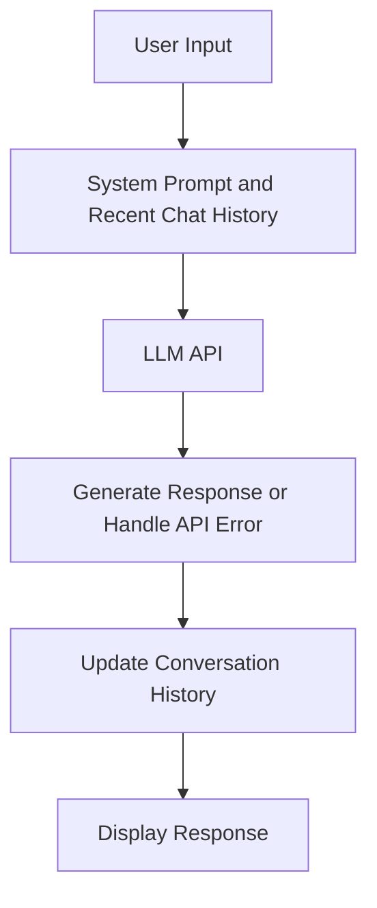

# Day 2 – Agentic AI: Sweet Crumbs Bakery Chatbot

## Overview
Day 2 focuses on developing an interactive AI-powered customer support chatbot for Sweet Crumbs Home Bakery using an LLM API and Python.

## Objectives
- Understand system, user and assistant message roles.
- Integrate an LLM using the OpenAI-compatible Python SDK.
- Design structured prompts using Role, Facts, Rules and Format.
- Maintain conversation history and manage context.
- Handle API rate limits and connection errors.

## Features
- Answers bakery-related questions about prices, eggless cakes and ordering policies.
- Supports English and Telugu responses.
- Maintains conversation context using recent messages.
- Preserves the system prompt while limiting the context to the latest eight conversation messages.
- Provides friendly fallback responses for unknown information and API errors.
- Supports interactive chat and exit commands: `bye`, `exit`, and `quit`.

## Technologies Used
- Python
- Google Colab
- OpenAI-compatible Python SDK
- Large Language Models (LLMs)
- Prompt Engineering

## Bakery Information
| Product | Price |
|---|---:|
| Plum Cake | ₹500 |
| Chocolate Cake | ₹650 |
| Cupcake | ₹80 |

All cakes have eggless versions. Orders require 24 hours' notice.

## Workflow

## How to Run
1. Open the Day 2 notebook in Google Colab.
2. Install the required Python SDK using the notebook's installation cell.
3. Configure the API key in Colab Secrets for the provider used in the notebook.
4. Set the model name and run the cells in order.
5. Enter questions in the interactive chatbot and type `exit` to stop.

Never publish your API key in the notebook or repository.

## Learning Outcomes
- LLM API integration and structured prompt design.
- Multi-turn conversations and context-window management.
- Basic exception handling for API-based applications.
- Development of a domain-specific customer support chatbot.

## Conclusion
Day 2 demonstrates how a basic LLM interaction can be extended into a conversational bakery assistant with memory, structured instructions and basic error handling.
